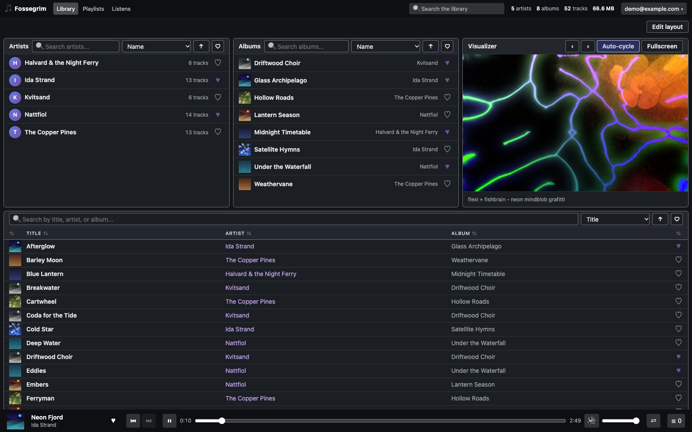
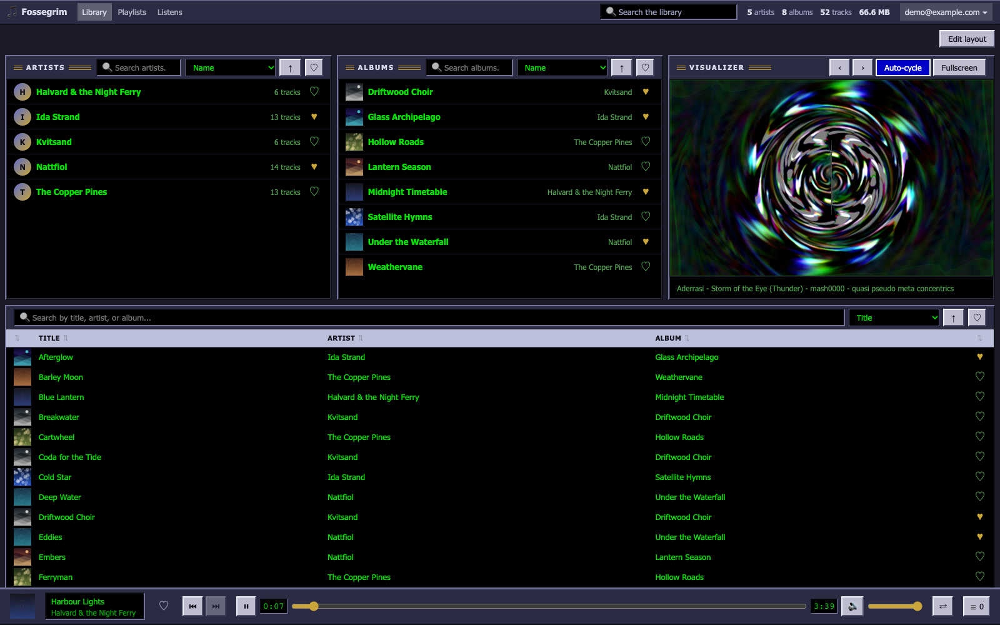
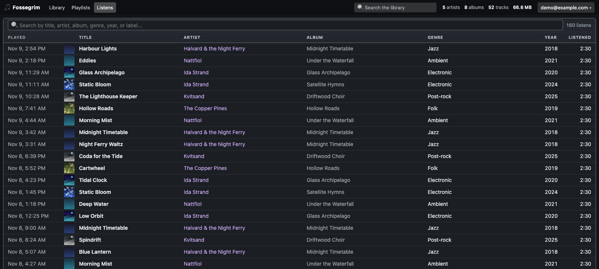
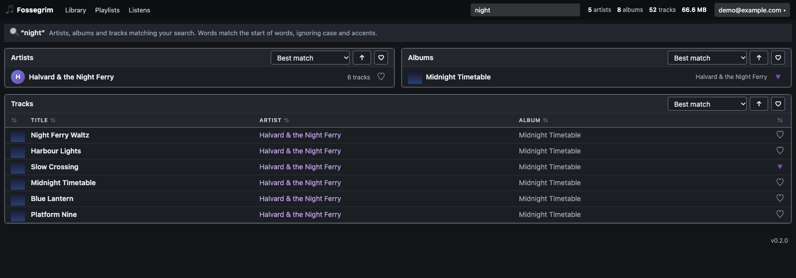
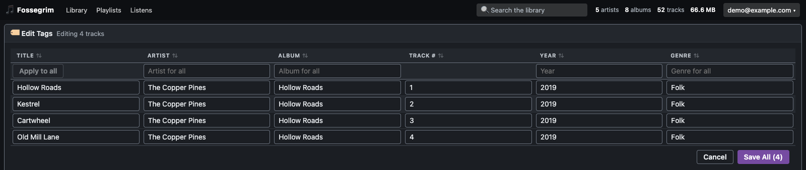

<div align="center">

# 🎻 Fossegrim

**A self-hosted music server and web player for the music collection you already own.**

[](https://github.com/slaptoast/fossegrim/actions/workflows/test.yml) [](https://github.com/slaptoast/fossegrim/releases/latest) [](https://github.com/slaptoast/fossegrim/pkgs/container/fossegrim) [](https://dotnet.microsoft.com/) [](LICENSE)



</div>

---

## About

Fossegrim turns a folder of music files into a private streaming service. Point it at your library, and everyone in your household gets their own account with a fast web player, their own playlists, favourites and listening history, and optional Last.fm scrobbling. All of it runs on your own hardware.

It's for people who keep their music as files (ripped CDs, Bandcamp purchases, years of carefully tagged MP3s) and want to listen anywhere on their network without handing the collection to a streaming service. It also helps look after the collection: it edits tags, finds album art, renames files from a template and spots tags that disagree.

The name comes from the *Fossegrimen*, a water spirit in Norwegian folklore who plays the fiddle beneath waterfalls.

> **Status:** early but complete enough for daily use. The first public release is **v0.2.0**. Releases follow semantic versioning; until 1.0, a minor version may include breaking changes, which the release notes will call out.

## Features

**Playback**
- Gapless playback, and crossfades of 1–12 seconds between tracks from different albums. Tracks from the same album always stay gapless.
- A queue ("Up next"): add tracks with a right-click, jump to any of them or remove them. Plus Previous, Next and seeking. Files stream as they are, with no transcoding.
- A [MilkDrop](https://en.wikipedia.org/wiki/MilkDrop) visualizer (via [Butterchurn](https://github.com/jberg/butterchurn), rendered with WebGL), with many presets, auto-cycling and fullscreen.
- A player bar at the top or bottom of the page, or a full Player panel on the Library page.

**Your library**
- Background library scans with live progress. A quick scan reads only new and changed files; a full rescan re-reads everything. You can rescan a single album or artist with a right-click, and other tools can start scans with an API key.
- Disc numbers, so multi-disc albums play disc by disc, plus album and file details (format, bitrate, length) for every track.
- Album covers on every list, resized and cached on the server.

**Finding music**
- Library-wide search from the top bar. It ignores case and accents and matches the start of each word.
- Search, sorting (name, artist, album, year, recently added, most played, recently played, recently favourited) and paging in every list.
- Random albums and tracks on the front page: fully random, or adjusted to favour what you haven't played recently, or ever. Optionally, playback keeps going when the queue runs out.

**Personal to each user**
- Favourite tracks, albums and artists, with hearts everywhere, a "favourites only" filter and a Favourites module.
- Playlists you can share with other users.
- A full listening history, plus "Recently played" modules that can also show what you haven't played lately.
- [Last.fm](https://www.last.fm/) scrobbling and "now playing", with retries when Last.fm is unreachable.

**Looking after the collection**
- A tag editor for one track or a whole album, with "apply to all" for shared fields.
- An album art editor that searches [MusicBrainz](https://musicbrainz.org/) / [Cover Art Archive](https://coverartarchive.org/) and Deezer, or takes an uploaded image.
- File renaming from a template such as `{artist}/{album}/{track:00} - {title}`, with a preview before anything moves.
- Library health reports: MP3s whose old ID3v1 tag disagrees with their ID3v2 tag, and files not named the way the template says. Each can be fixed in one click.

**Make it yours**
- Light, dark and system themes, a built-in Retro Amp theme, and custom themes with your own colours and CSS. Themes can be exported and imported.
- A Library page built from movable, resizable modules: artists, albums, tracks, visualizer, random picks, recents, favourites, up next and player.

**Running it**
- A setup wizard on first run. After that, an admin panel for media folders, accounts and sign-ups, email, Last.fm, backups and update checks.
- "Forgot password?" on the sign-in page: it emails a one-time reset link once an admin has set up a mail server (any SMTP server). Without one, admins can make a reset link for anyone, and a locked-out sole admin can get one with `fossegrim reset-password` ([DOCKER.md](DOCKER.md#forgotten-passwords)).
- Scheduled and on-demand backups of the database and keys, as zip files; [DOCKER.md](DOCKER.md#backups) explains how to restore from one.
- Release builds check once a day for a newer version and show an "Update available" badge to admins.
- Security: sign-in rate limiting and lockout, renewable sessions you can sign out per device, short-lived media tokens for stream URLs, and a strict Content-Security-Policy.

**Built for other apps too**
- A REST API with JWT bearer auth and renewable refresh tokens. Every list is paged and searchable, and there are endpoints for favourites, plays, playlists and covers. The web app uses exactly the same API a mobile app would.

## Screenshots

| | |
|:---:|:---:|
|  |  |
| **Themes:** the built-in Retro Amp theme | **Listening history**, searchable |
|  |  |
| **Search** across artists, albums and tracks | **Tag editor**, one track or many at once |

<sub>Screenshots show a demo library of generated music; every artist, album and cover in them is made up.</sub>

## What it handles

| | |
|---|---|
| **Audio formats** | MP3, FLAC, M4A (AAC/ALAC), Ogg Vorbis and Opus. Files play in the browser as they are, so a format plays wherever the browser supports it. |
| **Tags** | Read and written with [TagLib#](https://github.com/mono/taglib-sharp): title, artist, album, year, track and disc numbers, genre. Embedded art and `cover.jpg`-style folder art are both used. |
| **Library layout** | Any folder structure. Albums and artists come from tags, not folders. Several media folders can be registered. |
| **Users** | Any number of accounts, with admin and regular users. Favourites, playlists, history, themes and playback settings are per user. |
| **Browsers** | Current Chrome, Edge, Firefox and Safari. The visualizer needs WebGL 2. |
| **Server** | The image is `linux/amd64` and runs anywhere Docker does, including Docker Desktop on macOS and Windows. The database is SQLite, so there's nothing else to install. |

## Quick start

You need [Docker](https://docs.docker.com/get-docker/) with Compose.

```bash
git clone https://github.com/slaptoast/fossegrim.git
cd fossegrim
cp .env.example .env        # then set MUSIC_LIBRARY_PATH to your music folder
docker compose pull
docker compose up -d
```

Or, without cloning:

```bash
docker run -d --name fossegrim -p 8080:8080 \
  -v fossegrim-data:/data \
  -v /path/to/your/music:/music \
  -v /path/to/backups:/backups \
  ghcr.io/slaptoast/fossegrim:latest
```

Then open **http://localhost:8080**. The setup wizard walks you through creating the admin account (the only required step), adding `/music` as a media folder, and optionally Last.fm, accounts, backups and update checks.

> [!IMPORTANT]
> Until the first admin account exists, whoever reaches the wizard first becomes the admin. Finish setup before exposing the server to the internet, and put it behind HTTPS (a reverse proxy such as Caddy, Traefik or nginx).

### Configuration

Everything is configured with environment variables. The common ones:

| Variable | Default | Purpose |
|---|---|---|
| `MUSIC_LIBRARY_PATH` | `./music` | Your music folder, mounted read-write at `/music` (the tag editor and renamer write to it). |
| `BACKUP_PATH` | `./backups` | Where backup zips go. Ideally a different disk from `/data`. |
| `PORT` | `8080` | Host port to publish. |
| `JWT_KEY` | *generated* | Token signing key. Left empty, one is generated into `/data` on first run. |
| `LASTFM_API_KEY` / `LASTFM_API_SECRET` | | Optional. Usually entered on the admin Settings page instead. |

See **[DOCKER.md](DOCKER.md)** for the full reference: every setting, the security model, backups and restores, library scans, file renaming, and update checks.

### Updating

```bash
docker compose pull && docker compose up -d
```

Admins see an "Update available" badge in the footer when a newer release is published. Each release is tagged `X.Y.Z`, `X.Y`, `X` and `latest`, so you can pin to a minor version (for example `ghcr.io/slaptoast/fossegrim:0.2`) if you'd rather update by hand. The database migrates itself on startup; take a backup first (Admin → Backups).

## API

The web app is a pure client of the REST API, so anything it does, another app can do too:

- **Auth:** `POST /api/auth/login` returns an access token (60 minutes) and a refresh token that renews indefinitely. Each device appears under Profile → Signed-in devices and can be signed out there.
- **Browsing:** `/api/artists`, `/api/albums` and `/api/mediaitems` take `q`, `sort`, `order`, `page`, `pageSize`, `favorites=true` and `listened=true`. `/api/search?q=` searches everything at once.
- **Playback:** `/stream/{id}` (with range requests) and `/cover/{id}?size=256` use short-lived media tokens, so they work in `<audio>` and `` tags.
- **Your data:** favourites, plays, playlists and the queue under `/api/favorites`, `/api/plays` and `/api/playlists`.
- **Automation:** admins can create API keys that let scripts start library scans, for example after a download finishes.

In development, the OpenAPI document is served at `/openapi/v1.json`.

## Development

Requirements: the [.NET 10 SDK](https://dotnet.microsoft.com/download).

```bash
./run-dev.sh                       # API on :5182 and the web app on :5085, with hot reload
dotnet test src/Fossegrim.sln      # the full test suite
```

| Project | What it is |
|---|---|
| `src/Fossegrim.Api` | ASP.NET Core minimal API. It owns the database and serves the web app in production. |
| `src/Fossegrim.Web` | Blazor WebAssembly single-page app, a browser-only client of the API. |
| `src/Fossegrim.Lib` | Data and services: EF Core on SQLite, Identity, scanning, tags, search. |
| `src/Fossegrim.Contracts` | DTOs shared by the API and the web app. |
| `src/Fossegrim.Api.Tests` | xUnit tests that run the real API in-process against a throwaway database. |

Every pull request runs the tests and a Docker build. Pushing a `vX.Y.Z` tag publishes the image to GHCR and creates a [GitHub Release](https://github.com/slaptoast/fossegrim/releases) with generated notes. More detail is in **[DEV-README.md](DEV-README.md)**.

### Built with

[.NET 10](https://dotnet.microsoft.com/) · [ASP.NET Core](https://learn.microsoft.com/aspnet/core) · [Blazor WebAssembly](https://learn.microsoft.com/aspnet/core/blazor) · [EF Core](https://learn.microsoft.com/ef/core) + SQLite (with FTS5 full-text search) · [TagLib#](https://github.com/mono/taglib-sharp) · [SkiaSharp](https://github.com/mono/SkiaSharp) · [Butterchurn](https://github.com/jberg/butterchurn) · [GridStack.js](https://gridstackjs.com/)

## License

Fossegrim is free software, licensed under the **[GNU Affero General Public License v3.0](LICENSE)**. You may use, study, share and change it. If you run a modified version as a service for other people, you must offer them its source code.

Bundled third-party code keeps its own license. Butterchurn, its presets and GridStack.js are MIT-licensed; see `src/Fossegrim.Web/wwwroot/lib/`. Cover art search uses the MusicBrainz, Cover Art Archive and Deezer services, and scrobbling uses the Last.fm API. Fossegrim isn't affiliated with any of them.
